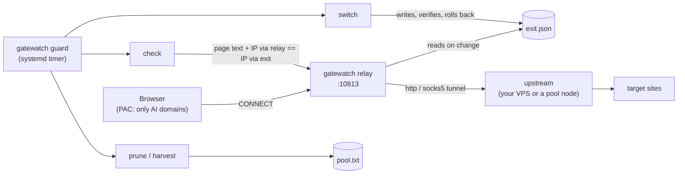

# Architecture

## Components

| Piece | Module | Job |
|---|---|---|
| relay | `relay.py` | HTTP CONNECT proxy. Opens every tunnel through the current exit (HTTP-CONNECT or SOCKS5 upstream, with credentials). Client allow-list. `/status` for allowed clients. |
| exit file | `state.py` | `state_dir/exit.json`, mode 0600, written atomically, previous version kept as `.bak`. |
| check | `check.py` | Judges the target pages by text; proves the relay uses the recorded exit. |
| pool | `pool.py` | `pool.txt` (one URL per line); a node is usable only if the test page opens through it. |
| harvest | `harvest.py` | Pulls candidates from public lists and tests them in parallel. |
| switch | `switch.py` | Picks the fastest usable node, writes the exit, verifies through the relay, rolls back on failure. |
| guard | `guard.py` | check, then prune, switch, forced switch, harvest, in that order; alerts on state *changes*. |
| PAC | `pac.py` | Generates and serves the PAC file (fails closed). |

## Decisions worth knowing

- **The exit is data, not configuration of a service.** No restarts, so no dropped streams and no restart loops.
- **The relay never improvises.** If the exit fails the client sees 502. Fallback exists only for hosts you list in `fallback_hosts` (for example a service that must use a different country), never as an automatic rescue.
- **`curl` does the fetching** for checks: it handles every proxy flavour and uses a real TLS stack. It is the only external dependency.
- **Alerts have hysteresis.** `guard` runs every few minutes but notifies only when the state flips (ok to failed, failed to ok).

## `gatewatch check` exit codes

| code | meaning |
|---|---|
| 0 | every target is a real page and the relay leaves through the recorded exit |
| 1 | a target answers with a stub page |
| 2 | a target is unreachable or too small to be the real page |
| 3 | no exit is set, or the relay is not using the recorded exit |

## Files in `state_dir`

`exit.json` (current exit), `exit.json.bak`, `pool.txt`, `guard.json` (last incident), `guard.lock`.
